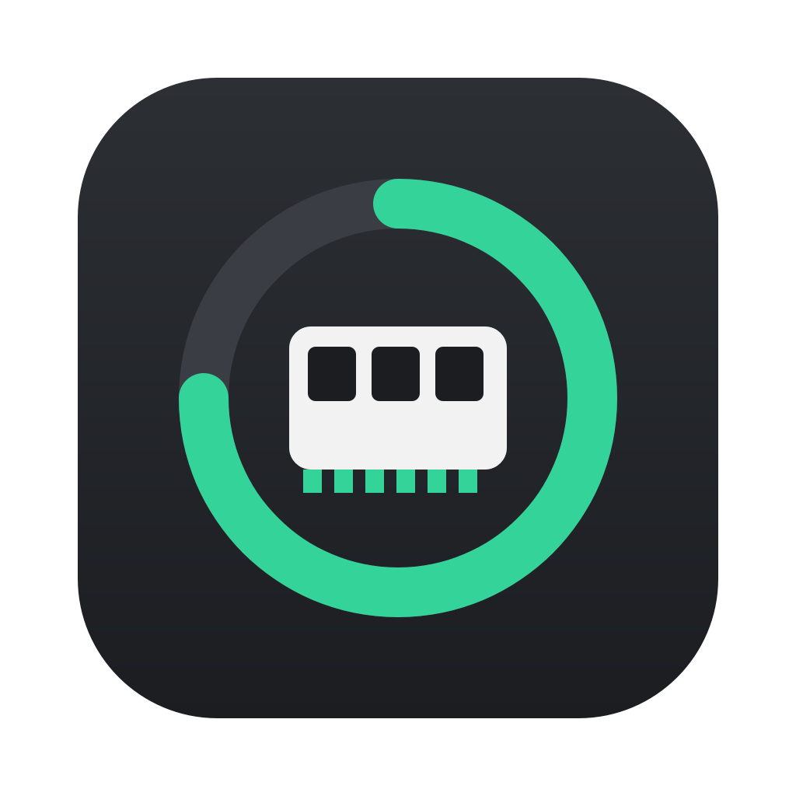

<p align="center"></p>

# mCLEAN

[](https://openmacapps.com/apps/mclean/) [](https://github.com/starbudweiser/mCLEAN/releases/latest) [](LICENSE)

A small macOS menu bar app that shows your Mac's memory at a glance and frees it in one click. A personal take on AppYogi's *Memory Cleaner* — not affiliated with its authors.

🇬🇧 English · 🇫🇷 [Français](#français)

## About

mCLEAN is a personal take on AppYogi's *Memory Cleaner*, not affiliated with its authors. Made by Starbudweiser & Claude Code (Anthropic). MIT License, © 2026 Starbudweiser. Provided as is, without warranty of any kind.

## Features

- **Live memory** in the menu bar: a ring with the percentage used (or the amount available), turning orange or red under memory pressure.
- **Panel** with the breakdown (app memory, wired, compressed, file cache, free), memory pressure, swap, a short history and the biggest apps.
- **Clean**: allocates memory in small steps to push the file cache out of RAM, then releases it. It stops as soon as the system shows any stress (pressure, swap or compression growing, low reserve, time limit). No password needed.
- **Deep clean**: also runs `purge` (asks for your administrator password) and goes after part of the app memory too.
- **Automatic clean** when available memory falls below a threshold, with a minimum delay between two runs. Never under high pressure: macOS handles that itself.
- **Inactive apps**: lists apps you have not used for a while, with a Quit button and optional notifications. Ignore list included.
- **Automatic updates** from GitHub releases (see below).
- Dark, light or system theme; menu bar display as icon, text or both; opens at login.
- Available in English, French, Spanish and Italian (follows the system language, English otherwise).

### How cleaning works

The system keeps recently used files in RAM (the file cache). It is reclaimable, but it is counted as used by many tools. mCLEAN asks the kernel for memory in 0.5 GB steps, which makes it evict that cache, then gives everything back. Each step re-reads the system state and stops on pressure, swap growth, compression growth, a 2 GB reserve limit or a time limit. Deep clean adds `purge` and a larger target.

## Install

Download `mCLEAN-X.Y.Z.zip` from the [latest release](https://github.com/starbudweiser/mCLEAN/releases/latest), unzip it and move `mCLEAN.app` to your Applications folder. The app is signed with a Developer ID and notarized by Apple. Requires macOS 14 or later.

### Updates

Once a day mCLEAN checks the latest GitHub release. If a newer version exists it downloads the zip, verifies the bundle identifier, the version and the code signature (which must match the running app's signing requirement), replaces itself and relaunches. This can be turned off in *Settings → Updates*, in which case an Install button appears in the panel instead.

## Build

```bash
swift test          # unit tests
./build.sh          # builds, signs and installs mCLEAN.app
```

`build.sh` signs with a local certificate through a helper script that is specific to the author's machine; edit the `SIGN_TOOL` line (or use `SIGN_IDENTITY="<certificate name>" ./build.sh`) to sign with your own. `release.sh` is the author's notarize-and-publish script and will not work as is.

Layout:

- `Sources/MCleanCore` — logic with no UI: memory probe, cleaning limits, settings, update parsing. Unit-tested.
- `Sources/mCLEAN` — the AppKit/SwiftUI app.
- `Resources/*.lproj` and `tools/strings_table.py` — texts in four languages (`python3 tools/gen_strings.py` regenerates the `.strings` files).

## Languages

English, French, Spanish and Italian. The app follows your Mac's preferred language automatically (English if it is none of these four).

## Support

Bug reports and suggestions: [GitHub Issues](https://github.com/starbudweiser/mCLEAN/issues).

## License

MIT, © 2026 Starbudweiser. See [LICENSE](LICENSE). Software provided "as is", without warranty of any kind.

---

## Français

Petite appli de barre de menus pour macOS qui affiche la mémoire du Mac d'un coup d'œil et la libère en un clic. Inspirée de *Memory Cleaner* d'AppYogi, sans lien avec ses auteurs.

- Mémoire en direct dans la barre de menus, panneau détaillé (mémoire des applis, câblée, compressée, cache de fichiers, pression, swap).
- Nettoyage sans mot de passe, nettoyage approfondi (`purge`), nettoyage automatique sous un seuil, liste des applis inactives.
- Mise à jour automatique depuis les releases GitHub.

Installation : téléchargez la [dernière version notarisée](https://github.com/starbudweiser/mCLEAN/releases/latest), décompressez-la et placez **mCLEAN.app** dans Applications (macOS 14 Sonoma ou plus récent).

Interface en français, anglais, espagnol et italien, choisie d'après la langue du Mac (anglais sinon). Licence MIT, © 2026 Starbudweiser. Questions et bugs : [Issues GitHub](https://github.com/starbudweiser/mCLEAN/issues).
